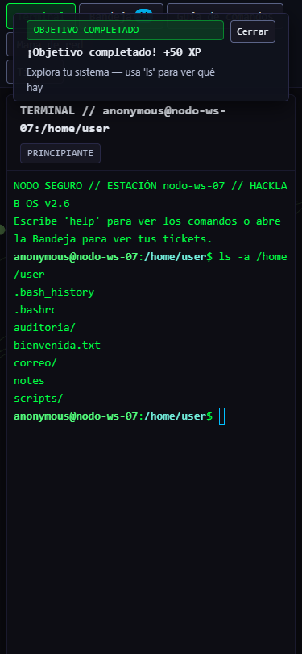

<div align="center">

# HackLab Game

**Aprende ciberseguridad hackeando, no leyendo.**

Un juego de terminal en el navegador donde aceptas contratos, escaneas redes y
rompes sistemas simulados mientras aprendes seguridad, scripting e ingeniería de software.


</div>


| Escritorio (1440 px)                                       | Celular (375 px)                                        |
| ---------------------------------------------------------- | ------------------------------------------------------- |
|  |  |

---

## Inicio rápido

Requisitos: **Node.js 26 LTS** (ver `.nvmrc`). También funciona con Node 24.15+.

```bash
git clone <url-del-repo> hacklab-game
cd hacklab-game
npm install
npm run dev
```

Abre `http://localhost:5173`. No necesitas cuentas, servidores ni API keys.

## Qué tiene

| Característica         | Detalle                                                                      |
| ---------------------- | ---------------------------------------------------------------------------- |
| Terminal real          | xterm.js con comandos como `ls`, `cd`, `nmap`, `ssh` y `crack`               |
| Contratos con historia | Misiones guiadas por CIPHER, tu contacto en la darknet                       |
| Dificultad progresiva  | 4 tiers: de _beginner_ con guías completas a _anonymous_ sin ninguna ayuda   |
| Fondos 3D              | Escenas con Three.js y React Three Fiber                                     |
| 100% en el navegador   | Sin servidor. El progreso se guarda en `localStorage` con esquema versionado |
| IA opcional            | Pistas con Ollama u otros proveedores. El juego funciona completo sin IA     |

## Scripts

| Comando                 | Qué hace                                               |
| ----------------------- | ------------------------------------------------------ |
| `npm run dev`           | Servidor de desarrollo con recarga en caliente         |
| `npm run build`         | Typecheck y build de producción en `dist/`             |
| `npm run check`         | Typecheck, lint, formato y pruebas: lo mismo que el CI |
| `npm run test`          | Pruebas con Vitest                                     |
| `npm run test:coverage` | Pruebas con reporte de cobertura                       |
| `npm run lint:fix`      | Corrige lo que ESLint pueda arreglar solo              |
| `npm run format`        | Formatea todo con Prettier                             |

## Arquitectura

```
src/
├── engine/     Lógica pura del juego: state machines, filesystem, contratos, reputación
├── terminal/   Terminal xterm.js, parser y un archivo por comando
├── story/      Narrativa y diálogos
├── scenes/     Fondos 3D
├── ui/         Componentes React (HUD, paneles, tienda, guías)
├── ai/         Módulo opcional de IA
├── data/       Contratos, herramientas y niveles en JSON
└── lib/        Tipos compartidos, event bus, logger y persistencia
```

La regla principal: **`engine/` no conoce la UI**. Es lógica pura y testeable, y ESLint
bloquea cualquier import de React o de la capa visual dentro de esa carpeta. Los comandos
de terminal tampoco tocan el engine directamente: reciben un `CommandContext` y devuelven
un `CommandResult`.

Las decisiones de arquitectura están en [`docs/decisions.md`](docs/decisions.md).

## Configuración opcional

Copia `.env.example` a `.env.local` solo si quieres activar la IA:

```bash
VITE_OLLAMA_URL=http://localhost:11434
```

## Contribuir

Lee [`CONTRIBUTING.md`](CONTRIBUTING.md). En resumen: rama desde `develop`, commits en
Conventional Commits, `npm run check` en verde y PR hacia `develop`.

## Licencia

[MIT](LICENSE)
