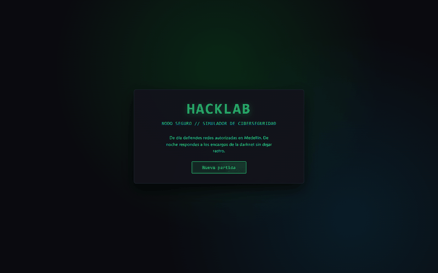
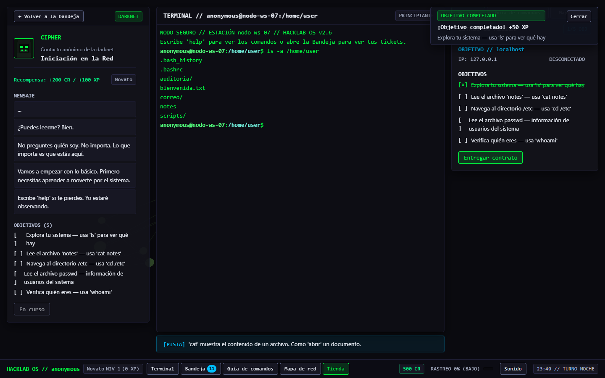

<div align="center">

# HackLab Game

**Aprende ciberseguridad hackeando, no leyendo.**

Un juego de terminal en el navegador donde aceptas contratos, escaneas redes y
rompes sistemas simulados mientras aprendes seguridad, Python e ingeniería de software.


### [▶ Jugar ahora en hacklab-game.vercel.app](https://hacklab-game.vercel.app)

</div>



| Escritorio (1440 px)                                       | Celular (375 px)                                        |
| ---------------------------------------------------------- | ------------------------------------------------------- |
|  |  |

---

## Inicio rápido

Para jugar no necesitas instalar nada: abre [hacklab-game.vercel.app](https://hacklab-game.vercel.app).
Para correrlo en tu equipo o contribuir:

Requisitos: **Node.js 26 LTS** (ver `.nvmrc`). También funciona con Node 24.15+.

```bash
git clone https://github.com/Luis-Vanegas/hacklab-game.git
cd hacklab-game
npm install
npm run dev
```

Abre `http://localhost:5173`. No necesitas cuentas, servidores ni API keys.

## Cómo se juega

Eres analista en **Nodo Seguro** y de día defiendes tu ciudad.

- **De día**, Marta Ríos te asigna tickets del canal _Trabajo_: revisar logs, detectar
  procesos raros, analizar phishing y aprender Python.
- **De noche**, CIPHER te ofrece encargos en la _Darknet_: escanear, entrar y salir sin
  que el rastreo llegue al 100 %.

Cada contrato da créditos y XP. Con la XP subes de nivel de reputación y desbloqueas
contratos nuevos; con los créditos compras herramientas en la tienda.

## Qué tiene

| Característica         | Detalle                                                                                 |
| ---------------------- | --------------------------------------------------------------------------------------- |
| Terminal real          | xterm.js con más de 40 comandos: `ls`, `grep`, `nmap`, `ssh`, `crack`, `python`, `edit` |
| Python de verdad       | Pyodide en un Web Worker: tus scripts corren en el navegador, aislados y sin red        |
| Editor integrado       | `edit archivo.py` abre el editor; `Ctrl+S` guarda en el filesystem virtual              |
| Contratos con historia | Dos canales: Marta (trabajo de día) y CIPHER (darknet de noche)                         |
| Dificultad progresiva  | 5 niveles de reputación, de _script_kiddie_ a _anonymous_                               |
| Fondos 3D              | Escenas con Three.js y React Three Fiber                                                |
| 100% en el navegador   | Sin servidor. El progreso se guarda en `localStorage` con esquema versionado            |

> La primera vez que ejecutas `python`, el juego descarga el intérprete (unos 6 MB
> comprimidos). Las siguientes ejecuciones de la partida reutilizan el intérprete ya cargado.

## Scripts

| Comando                 | Qué hace                                               |
| ----------------------- | ------------------------------------------------------ |
| `npm run dev`           | Servidor de desarrollo con recarga en caliente         |
| `npm run build`         | Typecheck y build de producción en `dist/`             |
| `npm run check`         | Typecheck, lint, formato y pruebas: lo mismo que el CI |
| `npm run test`          | Pruebas con Vitest                                     |
| `npm run test:coverage` | Pruebas con reporte de cobertura                       |
| `npm run lint:fix`      | Corrige lo que ESLint pueda arreglar solo              |
| `npm run format`        | Formatea todo con Prettier                             |

## Arquitectura

```
src/
├── engine/     Lógica pura del juego: state machines, filesystem, contratos, reputación
├── store/      Zustand: une parser, comandos y engine; el worker de Python vive aquí
├── terminal/   Terminal xterm.js, parser y un archivo por comando
├── story/      Narrativa y diálogos
├── scenes/     Fondos 3D
├── ui/         Componentes React (escritorio, HUD, editor, tienda, guías)
├── ai/         Módulo opcional de IA (aún sin conectar)
├── data/       Contratos, herramientas, niveles y filesystem inicial en JSON
└── lib/        Tipos compartidos, event bus, logger y persistencia
```

La regla principal: **`engine/` no conoce la UI**. Es lógica pura y testeable, y ESLint
bloquea cualquier import de React o de la capa visual dentro de esa carpeta. Los comandos
de terminal tampoco tocan el engine directamente: reciben un `CommandContext` y devuelven
un `CommandResult`. La UI solo habla con el juego a través de los hooks de `@/store`.

Las decisiones de arquitectura están en [`docs/decisions.md`](docs/decisions.md).

## Hoja de ruta

- [x] Fase 1 — MVP jugable
- [x] Fase 2 — Experiencia de juego (historia, escritorio, sonido, accesibilidad)
- [x] Fase 3 — Python real con Pyodide y curso guiado
- [ ] Fase 4 — IA opcional: pistas con modelos locales (Ollama). El juego seguirá
      funcionando completo sin IA

## Contribuir

Lee [`CONTRIBUTING.md`](CONTRIBUTING.md). En resumen: rama desde `develop`, commits en
Conventional Commits, `npm run check` en verde y PR hacia `develop`.

## Licencia

[MIT](LICENSE)
